<picture><source media="(prefers-color-scheme: dark)" srcset="assets/hero-dark.svg"></picture>

<picture><source media="(prefers-color-scheme: dark)" srcset="assets/social-l-dark.svg"></picture><a href="https://t.me/pxl_serv"><picture><source media="(prefers-color-scheme: dark)" srcset="assets/social-1-dark.svg"></picture></a><picture><source media="(prefers-color-scheme: dark)" srcset="assets/social-r-dark.svg"></picture>

<picture><source media="(prefers-color-scheme: dark)" srcset="assets/about-dark.svg"></picture>

<picture><source media="(prefers-color-scheme: dark)" srcset="assets/stack-dark.svg"></picture>

<a href="https://github.com/kakixc/PXLNET-Connect"><picture><source media="(prefers-color-scheme: dark)" srcset="assets/project-pxlnet-connect-dark.svg"></picture></a>&nbsp;<a href="https://github.com/kakixc/pxl-meshtastic-firmware"><picture><source media="(prefers-color-scheme: dark)" srcset="assets/project-pxl-meshtastic-firmware-dark.svg"></picture></a>

<a href="https://github.com/kakixc/autopolivalka"><picture><source media="(prefers-color-scheme: dark)" srcset="assets/project-autopolivalka-dark.svg"></picture></a>&nbsp;<a href="https://github.com/kakixc/Norma0"><picture><source media="(prefers-color-scheme: dark)" srcset="assets/project-norma0-dark.svg"></picture></a>

<picture><source media="(prefers-color-scheme: dark)" srcset="assets/stats-dark.svg"></picture>

<picture><source media="(prefers-color-scheme: dark)" srcset="assets/streak-dark.svg"></picture>

<picture><source media="(prefers-color-scheme: dark)" srcset="assets/wave-dark.svg"></picture>

<a href="https://github.com/kakixc?tab=repositories"><picture><source media="(prefers-color-scheme: dark)" srcset="assets/button-1-dark.svg"></picture></a>

<a href="https://metawka.github.io/expressive-profile/?from=kakixc"><picture><source media="(prefers-color-scheme: dark)" srcset="assets/credit-dark.svg"></picture></a>

